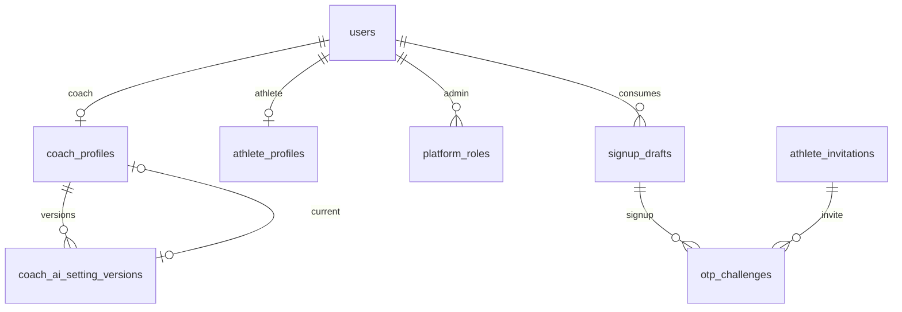
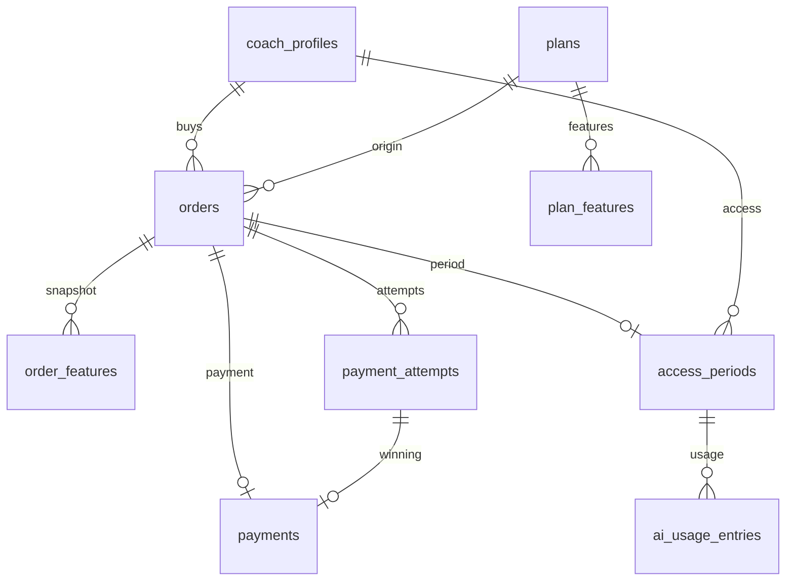
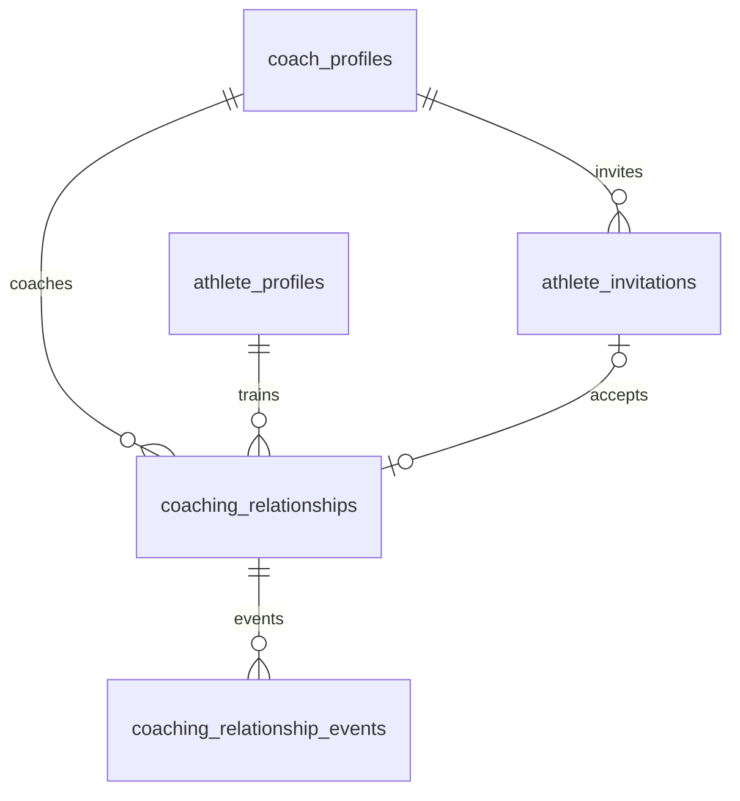
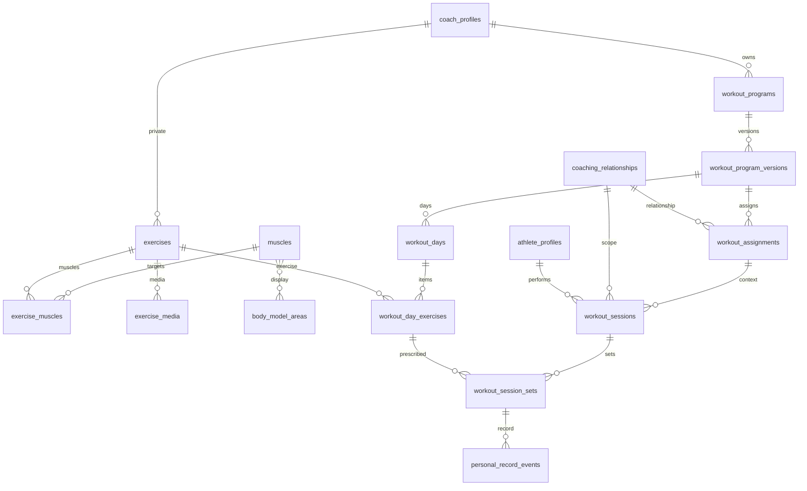
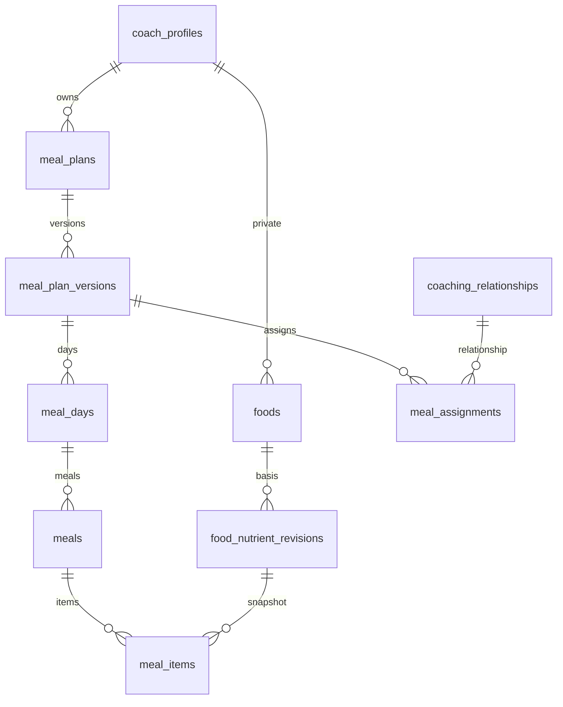
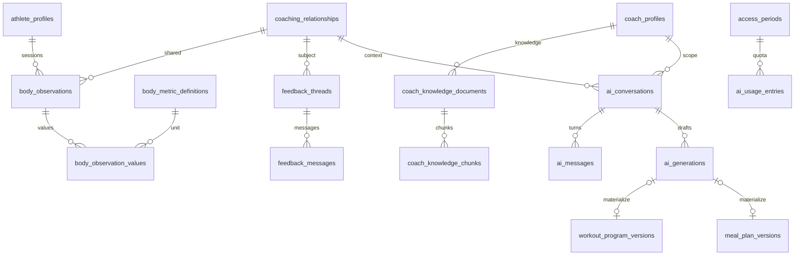

# نمودار موجودیت‌ها

نمودارها همان مدل [02-database.md](02-database.md) هستند و برای خوانایی دامنه به دامنه جدا شده‌اند. `users` در چند نمودار تکرار شده تا مرز هر دامنه پیدا باشد. برچسب خط‌ها شناسه انگلیسی رابطه است تا در چاپ راست‌به‌چپ به‌هم نریزد. معنی فارسی در بخش «رابطه‌های اصلی» سند بررسی آمده است.

## هویت و پروفایل

## پلن و دسترسی

## دعوت و رابطه

یک زوج مربی و ورزشکار فقط یک ردیف رابطه دارد. چند مربی برای یک ورزشکار چند ردیف با `coach_profile_id` متفاوت است.

## تمرین تجویزی و عملکرد

## تغذیه

## بدن، بازخورد و دستیار

