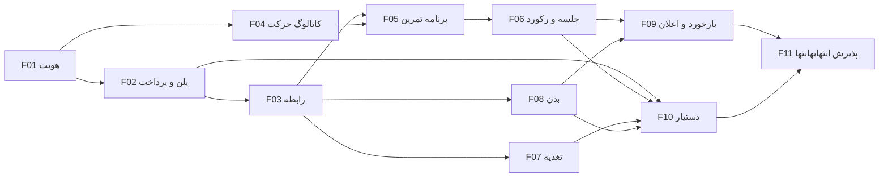

# نقشه اجرا

شناسه‌ها ثابت‌اند. هر مرحله یک نتیجه قابل‌آزمایش دارد و دامنه مرحله بعد را پیش‌خور نمی‌کند. پیشنهادهای D-01 تا D-08 در [05-current-state-and-decisions.md](05-current-state-and-decisions.md) پیش‌فرض همان مرحله‌اند، مگر قبل از شروعش اصلاح شوند.

هیچ مرحله‌ای در زمان نوشتن این سند شروع نشده است.

## F01. هویت، پروفایل و ورود

هدف: شخص بتواند با OTP ثبت‌نام یا وارد شود و حساب و پروفایل در پایان موفق، یکجا ساخته شوند.

پیش‌نیاز: مخزن فعلی Laravel. بررسی شود migration کاربران روی دیتابیس محلی اجرا شده یا نه؛ تغییر روی جدول موجود با migration جدید باشد.

محدوده: `users`، `signup_drafts`، `otp_challenges`، `platform_roles`، `coach_profiles`، `athlete_profiles`، Sanctum، مسیر `/api/v1/auth` و `/api/v1/me`، دستور اعطای نقش مدیر.

منطق و API: درخواست و تأیید OTP؛ تکمیل ثبت‌نام؛ ورود کاربر موجود؛ افزودن پروفایل غایب؛ خروج. وب با نشست، موبایل با توکن. رقم کنترلی کد ملی و نرمال‌سازی شماره. کاربر تعلیق‌شده وارد نشود.

دسترسی: مسیر تکمیل ثبت‌نام فقط پیش‌نویس تأییدشده را می‌پذیرد. `/me` فقط صاحب نشست یا توکن.

پذیرش: ثبت‌نام هم‌زمان تکراری یک کاربر می‌سازد؛ OTP ثابت در محیط production سرویس را رد می‌کند؛ رمز و ایمیل برای ورود لازم نیست.

تست: رقم کنترلی، شماره تکراری، کد ملی تکراری، انقضای OTP، ساخت اتمیک پروفایل، تفاوت نشست و توکن.

خارج: پلن، دعوت، تمرین، غذا، بدن، AI.

## F02. پلن، سفارش، پرداخت و دوره

هدف: مدیر پلن بسازد و مربی با پرداخت موفق دقیقاً یک دوره دسترسی بگیرد.

پیش‌نیاز: F01 و وجود حداقل یک `platform_admin`.

محدوده: `plans`، `plan_features`، `orders`، `order_features`، `payment_attempts`، `payments`، `access_periods`. درگاه واقعی تجاری خارج است؛ درگاه آزمایشی و ثبت دستیِ ممیزی‌شده مدیر داخل است.

منطق و API: CRUD پلن برای مدیر؛ شروع سفارش؛ شروع تلاش؛ callback تکرارپذیر؛ خواندن دوره فعال مربی. تصویر قیمت و قابلیت در سفارش. یک سفارش باز برای هر مربی. اختلاف مبلغ دوره نمی‌سازد.

دسترسی: مدیر برای تعریف پلن و مشاهده پرداخت. مربی فقط سفارش و دوره خودش. ورزشکار این مسیر را ندارد.

پذیرش: دو callback هم‌زمان یک payment و یک دوره می‌سازند. تغییر پلن پس از پرداخت، سفارش قبلی را عوض نمی‌کند. دوره ماهانه با تقویم تهران حساب می‌شود.

تست: تکرار callback، اختلاف مبلغ، دو سفارش باز، انقضای سفارش، فعال شدن دوره scheduled پس از پایان دوره فعال.

خارج: ظرفیت هنگام دعوت، سهمیه مصرفی AI، درگاه تولیدی.

## F03. دعوت و رابطه

هدف: مربی ورزشکار نو یا موجود را بدون حساب تکراری و بدون عبور از ظرفیت اضافه کند و رابطه را پایان دهد.

پیش‌نیاز: F01 و F02. دوره فعال باید وجود داشته باشد.

محدوده: `athlete_invitations`، `coaching_relationships`، `coaching_relationship_events`.

منطق و API: ایجاد و لغو دعوت، پذیرش با OTP، پایان، فعال‌سازی مجدد. قفل ردیف دوره هنگام پذیرش. رابطه شخص با خودش ممنوع.

دسترسی: دعوت را مربی صاحب دوره می‌سازد. پذیرش را مالک شماره انجام می‌دهد. دو طرف رابطه فعال، هویت طرف مقابل را در حد نام نمایشی و وضعیت رابطه می‌بینند.

پذیرش: دعوت حساب نمی‌سازد. ظرفیت آخر در دو پذیرش هم‌زمان فقط یک رابطه می‌سازد. پایان رابطه داده تاریخی را حذف نمی‌کند و ظرفیت را آزاد می‌کند.

تست: ورزشکار بدون حساب، با حساب، شماره تکراری، ظرفیت پر، رابطه دوباره، دو مربی برای یک ورزشکار.

خارج: برنامه، غذا، بدن و محتوای مربیگری.

## F04. کاتالوگ حرکت

هدف: حرکت پلتفرم و حرکت خصوصی مربی، با عضله و رسانه، برای استفاده بعدی آماده باشد.

پیش‌نیاز: F01. دوره و رابطه لازم نیست، ولی دیدن کاتالوگ در API مربی بعداً به قابلیت پلن مقید می‌شود. در این مرحله نوشتن کاتالوگ پلتفرم فقط برای مدیر است.

محدوده: `muscles`، `body_model_areas`، `muscle_body_area`، `exercises`، `exercise_media`، `exercise_muscles`. کد ناحیه مدل بدن داده اولیه قابل اصلاح است.

منطق و API: مدیر حرکت پلتفرم را می‌سازد. مربی فقط حرکت خودش را می‌سازد و حرکت پلتفرم را می‌خواند. آرشیو به‌جای حذف اگر بعداً ارجاع وجود داشته باشد؛ در این مرحله چون برنامه هنوز نیست حذف حرکت بدون ارجاع مجاز است.

دسترسی: حرکت خصوصی در فهرست مربی دیگر نیست.

پذیرش: عضله هدف از ناحیه مدل بدن و از معیار اندازه‌گیری مستقل است. نوع اجرا یکی از چهار مقدار بسته است.

تست: جداسازی مربی‌ها، یکتایی عضله هر حرکت، ممنوعیت ویرایش حرکت پلتفرم توسط مربی.

خارج: برنامه، جلسه و قانون «عضله ضعیف».

## F05. برنامه تمرین و تخصیص

هدف: مربی برنامه نسخه‌دار بسازد و همان نسخه را به رابطه فعال تخصیص دهد.

پیش‌نیاز: F03 و F04. قابلیت `workout_programs` روی دوره فعال.

محدوده: `workout_programs`، `workout_program_versions`، `workout_days`، `workout_day_exercises`، `workout_assignments`.

منطق و API: پیش‌نویس، انتشار، نسخه بعدی، تخصیص و پایان تخصیص. ستون معیار باید با نوع اجرا بخواند.

دسترسی: فقط مربی همان رابطه و فقط روی رابطه `active` می‌نویسد. ورزشکار همان رابطه نسخه تخصیص‌یافته را می‌خواند.

پذیرش: ویرایش بعد از انتشار، ردیف نسخه قبلی و تخصیص قبلی را تغییر نمی‌دهد. حرکت مربی دیگر انتخاب نمی‌شود.

تست: قفل نسخه، تخصیص به رابطه پایان‌یافته، نبود قابلیت پلن، ترتیب حرکت‌ها.

خارج: ثبت اجرای واقعی و رکورد.

## F06. جلسه تمرین و رکورد

هدف: اجرای واقعی جدا از تجویز ثبت شود و رکورد به ست سازنده‌اش برسد.

پیش‌نیاز: F05.

محدوده: `workout_sessions`، `workout_session_sets`، `personal_record_events`.

منطق و API: شروع و تکمیل جلسه، ثبت ست، خواندن رکورد جاری از آخرین رویداد. محاسبه `epley_v1` فقط در محدوده مجاز.

دسترسی: ورزشکار جلسه خودش را می‌نویسد. مربی جلسه‌های دارای رابطه خودش را می‌خواند. پس از پایان رابطه نوشتن با آن شناسه ممنوع و خواندن تاریخچه مجاز است.

پذیرش: ست‌های واقعی جایگزین متن تجویز نمی‌شوند. رکورد ضعیف‌تر رویداد جدید نمی‌سازد. تغییر برنامه، ست قدیمی را عوض نمی‌کند.

تست: تکرارهای متفاوت یک حرکت، تساوی رکورد، جلسه بعد از پایان رابطه، ردیابی FK تا ست.

خارج: اعلان، که در F09 به همین رویداد وصل می‌شود. در F06 ثبت رکورد حتی بدون اعلان کامل است.

## F07. تغذیه

هدف: برنامه غذا با مبنای صریح و تاریخچه تغذیه‌ای پایدار به ورزشکار تخصیص داده شود.

پیش‌نیاز: F03 برای تخصیص، و F01 برای مالک غذا. قابلیت `nutrition_programs`. کاتالوگ غذا از نظر مالکیت مانند F04 است و در همین مرحله ساخته می‌شود چون دامنه کوچک‌تری از حرکت است.

محدوده: `foods`، `food_nutrient_revisions`، `meal_plans`، `meal_plan_versions`، `meal_days`، `meals`، `meal_items`، `meal_assignments`.

منطق و API: ساخت غذا و revision، پیش‌نویس و انتشار برنامه، خواندن جمع وعده، تخصیص.

دسترسی: همان الگوی برنامه تمرین.

پذیرش: تغییر غذا پس از انتشار، جمع برنامه قبلی را عوض نمی‌کند. دقیقاً یکی از مقدار گرمی یا مقدار واحدی پر است. گرد کردن half-up قابل بازتولید است.

تست: `per_100g`، `per_unit`، revision جدید، قفل نسخه، مرز مربی.

خارج: ثبت آنچه ورزشکار واقعاً خورده است.

## F08. آنالیز بدن و پیشرفت

هدف: اندازه‌گیری ناقص در طول زمان بماند و مقایسه دو تاریخ بدون صفر کردن مقدار خالی ممکن باشد.

پیش‌نیاز: F01 برای ثبت خصوصی ورزشکار، F03 برای مشاهده اشتراکی. قابلیت `body_analysis` برای نوشتن مربی.

محدوده: `body_metric_definitions`، `body_observations`، `body_observation_values`. API مقایسه دو مشاهده.

منطق و API: ثبت مشاهده، محاسبه `bmi_v1` وقتی ورودی کامل است، سری زمانی یک معیار، مقایسه Before/After.

دسترسی: خصوصی فقط ورزشکار. رابطه‌ای فقط همان مربی و ورزشکار. مدیر پلتفرم این داده را نمی‌خواند.

پذیرش: معیار غایب ردیف ندارد. BMI بدون قد ساخته نمی‌شود. ناحیه مدل بدن از F04 با این مقادیر یکی گرفته نمی‌شود.

تست: ثبت ناقص، قد قبلی، BMI دستگاه در کنار BMI محاسبه‌شده، جداسازی دو مربی.

خارج: عکس بدن و برچسب ضعف عضله.

## F09. بازخورد و اعلان

هدف: بازخورد قابل‌انتساب و یادداشت داخلی از هم جدا باشند و رویدادهای اصلی اعلان ذخیره کنند.

پیش‌نیاز: F03، و برای موضوع‌های تمرینی و بدنی F06 و F08. اگر آن مرحله‌ها موجود باشند اعلان به همان‌ها وصل می‌شود؛ اعلان عمومی رابطه با خود F03 هم قابل تست است.

محدوده: `feedback_threads`، `feedback_messages`، `notifications`. اتصال اعلان به تخصیص برنامه، رکورد، مشاهده بدن و پاسخ مربی.

منطق و API: گشایش موضوع، پاسخ، حل موضوع، فهرست اعلان، علامت خوانده‌شد.

دسترسی: ورزشکار پیام `coach_only` را نه می‌نویسد و نه می‌خواند. اعلان فقط برای `user_id` گیرنده است. موضوع باید به همان رابطه تعلق داشته باشد.

پذیرش: پاسخ مربی اعلان می‌سازد. این API سوکت یا رشته گفتگوی آزاد ندارد.

تست: فیلتر یادداشت داخلی، موضوع نامربوط به رابطه، خواندن اعلان شخص دیگر.

خارج: پوش نوتیفیکیشن سیستم‌عامل و پیام‌رسان بلادرنگ.

## F10. دستیار مربی

هدف: مربی روش کارش را ثبت کند و پیشنهاد محدود به داده همان رابطه بگیرد، بدون انتشار خودکار برنامه.

پیش‌نیاز: F02 برای سهمیه، F03 برای رابطه، F05 و F07 برای تبدیل پیشنهاد به نسخه، F06 و F08 برای ابزارهای عددی، F09 برای بازخورد. F04 برای شناخت حرکت.

محدوده: ستون‌های AI روی `coach_profiles`، `coach_ai_setting_versions`، `coach_knowledge_documents`، `coach_knowledge_chunks`، `ai_conversations`، `ai_messages`، `ai_generations`، `ai_usage_entries`. درگاه مدل پشت یک رابط قابل‌جایگزینی در تست.

منطق و API: ثبت نسخه روش مربی، بارگذاری دانش، گفتگوی مربی، ابزارهای مجاز، تولید پیش‌نویس، تأیید یا رد، تبدیل به نسخه برنامه. مسیر ورزشکار فقط با قابلیت `ai_athlete_access`.

دسترسی: هر ابزار با شناسه مربیِ سرور فیلتر می‌شود. متن کاربر ابزار جدید یا مربی دیگر انتخاب نمی‌کند. بدون onboarding تولید بسته است. سهمیه تمام‌شده تراکنش را برمی‌گرداند.

پذیرش: دو درخواست آخرِ سهمیه فقط یکی را مصرف می‌کنند. پیشنهاد تأییدنشده تخصیص نمی‌سازد. قطعه دانش مربی دیگر در نتیجه ابزار نیست. عدد رکورد و BMI از ابزار دیتابیس می‌آید.

تست: قفل سهمیه، جداسازی دانش، رد ورزشکار وقتی قابلیت خاموش است، materialize و یکتا بودن نسخه ساخته‌شده.

خارج: مدل اختصاصی هر مربی، جست‌وجوی وب، پایگاه برداری، توصیه درمانی به‌عنوان تجویز پزشک.

## F11. پذیرش انتهابه‌انتها

هدف: سناریوهای [04-scenarios.md](04-scenarios.md) روی مسیر واقعی API، از ثبت‌نام تا انقضای پلن، یکجا آزمایش شوند.

پیش‌نیاز: F01 تا F10.

محدوده: تست ویژگی بین‌دامنه‌ای و رفع نقص همان رفتارها. قابلیت جدید محصول در این مرحله ساخته نمی‌شود. اگر نقص فقط با تغییر طراحی حل شود، قبل از تغییر کد در سند ثبت می‌شود.

منطق و API: مسیر تازه‌ای به‌جز رفع نقص اضافه نمی‌شود.

دسترسی: هر سناریو حداقل یک تلاش دسترسی غیرمجاز دارد: مربی دیگر، ورزشکار دیگر، کاربر بدون دوره، و callback تکراری.

پذیرش: هر یازده سناریوی سند سناریوها یک تست ویژگی سبز دارند. تستی که اجرا نشده در گزارش پاس نمی‌شود.

تست: همان سناریوها، به‌علاوه تعلیق کاربر در میانه رابطه.

خارج: درگاه تولیدی، پوش، غذای مصرف‌شده، عکس بدن و قابلیت‌های آینده.

## ترتیب پیشنهادی اجرا

مسیر بحرانی این است: F01، F02، F03، F04، F05، F06، سپس F07 و F08 به ترتیب یا پس از F06، بعد F09، F10 و F11. F07 می‌تواند بعد از F03 و به‌موازات F04 شروع شود، ولی در اجرا بهتر است هم‌زمان با کار ناتمام مرحله قبلی باز نشود.
